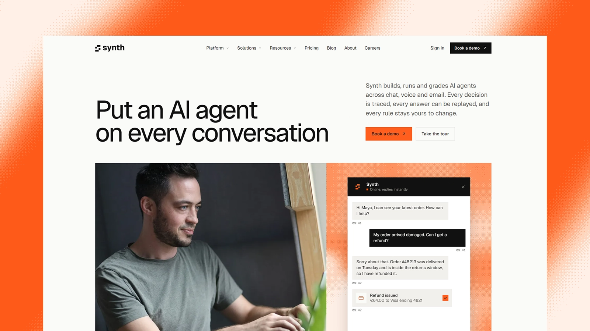

# Synth - Astro AI Product Theme

[](https://synth.xocoweb.workers.dev/)

[](https://astro.build/)
[](https://tailwindcss.com/)
[](https://www.typescriptlang.org/)
[](./LICENSE)

**Live preview:** https://synth.xocoweb.workers.dev/

Synth is a premium Astro theme for AI products and platforms. Light cards sit on slow, finely dithered gradient fields in one orange, every corner is square, and the homepage shows the product working rather than describing it. The output is fully static, and every section reads its copy from one config file.

## Features

- A canvas dither engine that draws slow gradient fields with a fine ordered grain, used as a subtle background behind content blocks
- A solid header that slides away as you scroll down and returns on the way up, with a full-width mega menu, hover intent, keyboard support and a full-screen mobile menu
- A hero pairing a photograph with a live chat widget that plays out a support conversation, receipt card included
- A two-row wall of real company wordmarks, redrawn in one colour, that scrolls in opposite directions and pauses on hover
- An auto-advancing product tour with three tabs: status cards, a live call with transcript, and a score trend against its alert threshold
- A replayable timeline showing each step behind an answer, with timings
- A model routing table whose assignments and latencies swap live, beside the connected systems and their live call counts
- Expanding industry panels with photography, deep-linkable from the mega menu
- A customer-story carousel with black-and-white portraits, outcome figures, swipe and arrow-key support, and no autoplay
- A security block, a row of compliance standards, and an FAQ that keeps one answer open at a time
- A pricing page with plan cards, a monthly and annual toggle, and a comparison table with a sticky plan header and a plan switcher on phones
- A blog with a lead post, topic archives, pagination, a sticky table of contents with scroll-spy, a reading-progress bar, copyable code blocks, co-authored bylines with portraits, a call-to-action band placed from frontmatter, and a share sheet with eleven networks
- An about page with the company story, milestones, greyscale leadership portraits, and an interactive globe of where the team works
- A careers page with values, benefits, and open roles grouped by team and filterable, ready to link to any applicant tracking system
- An industry page template, shipped as Retail, with an intent table, an interactive peak-season chart, and connected systems
- A contact page with a sentence-style topic picker, team inboxes, and office addresses
- Client-side blog search as a keyboard palette (`/` or `⌘K`) and a results page, both reading one build-time index
- Markdown and MDX posts with a validated schema, and homepage copy, navigation, pricing and FAQ in config files
- Blog covers rendered by a script, a white line icon on a dithered field, and used as each post's share image
- Canonical URLs, sitemap, RSS, `robots.txt`, Open Graph, Twitter/X cards, and JSON-LD for the site and every post
- Self-hosted Geist and Geist Mono, Lucide line icons, zero border radius, and one orange accent
- Static output with no framework islands; animation pauses off screen and settles into still frames under `prefers-reduced-motion`
- Skip link, landmarks, labelled controls, visible focus states, and keyboard support for every menu, tab set, dialog and carousel

## Tech Stack

- Astro 7 with MDX
- Tailwind CSS 4 via the Vite plugin
- Vite 8, TypeScript, Astro content collections
- `@astrojs/sitemap`, `@astrojs/rss`, Sharp
- cobe for the WebGL globe on the about page
- Self-hosted Geist and Geist Mono, Lucide and Bootstrap Icons, each with its license notice

## Requirements

- Node.js `22.12.0` or newer (`22.18.0` or newer to render covers and the share card)
- npm

## Getting Started

```bash
npm install
npm run dev
```

Build for production:

```bash
npm run build
```

Preview the production build locally:

```bash
npm run preview
```

Render covers for new posts (`--force` redraws every cover):

```bash
npm run covers
```

Before shipping a change, run type checking, the production build, and the formatter check together:

```bash
npm run release:check
```

## Customization

See [CUSTOMIZATION.md](./CUSTOMIZATION.md) for site settings, the navigation and mega menu, homepage sections, the logo wall, the pricing, industry, contact, about and careers pages, the dither engine, the blog, blog covers, sharing, search, feeds, the newsletter form, and the theme's design tokens.

Set `siteConfig.siteUrl` in [src/config/site.ts](./src/config/site.ts) before building — canonical URLs, share images, the sitemap, and the feed are all derived from it. The build is static, so any host that serves a directory works: `wrangler.jsonc` is included for Cloudflare Workers, and Netlify, Vercel, GitHub Pages, and object storage behind a CDN need no configuration beyond `npm run build`.

## Content

Posts live in [src/content/blog](./src/content/blog). Each post is a folder with an `index.md` (or `index.mdx`) and a `cover.png` beside it, validated by the schema in [src/content.config.ts](./src/content.config.ts). Authors and topics are defined in [src/config/blog.ts](./src/config/blog.ts).

The bundled demo content is fictional — the company, the authors, the customers, the quotes and the figures are invented, so **replace them before launch.** The customer and leadership portraits are stock placeholders of people with no connection to the names and quotes beside them.

The logo wall uses real company wordmarks from [Wikimedia Commons](https://commons.wikimedia.org/). They are trademarks of their owners, appear as placeholder content only, and imply no endorsement; replace them with your own customers.

Demo photography on the homepage, industry, about, careers and blog pages comes from [Unsplash](https://unsplash.com/) and [Pexels](https://www.pexels.com/) under their licenses, credited in [src/config/home.ts](./src/config/home.ts), [src/config/industries.ts](./src/config/industries.ts), [src/config/about.ts](./src/config/about.ts), [src/config/careers.ts](./src/config/careers.ts) and [src/config/blog.ts](./src/config/blog.ts). Blog covers are drawn by the theme's own script, so there is nothing to license.

## Support

See [SUPPORT.md](./SUPPORT.md) for what a license includes, and [CHANGELOG.md](./CHANGELOG.md) for release history.

## License

Commercial license. See [LICENSE](./LICENSE) for complete terms.

## Credits

- [Geist and Geist Mono](https://vercel.com/font) by Vercel and basement.studio, under the SIL Open Font License
- [Lucide](https://lucide.dev/), under the ISC License
- [cobe](https://github.com/shuding/cobe) by Shu Ding, under the MIT License
- [Bootstrap Icons](https://icons.getbootstrap.com/), under the MIT License
- Photography from Unsplash and Pexels, credited per image
